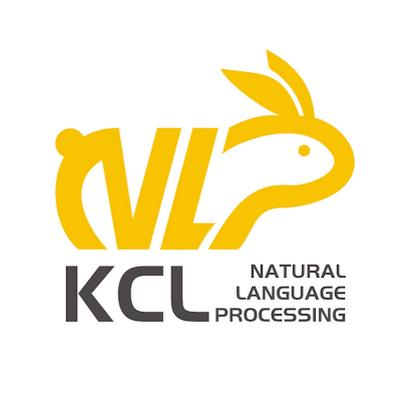

# GroupAssistBench

### One Assistant, Many Memories: Benchmarking Real-World Group Assistance When Recall Is Not Enough

Zhanghao Hu*, Linhai Zhang*, Qian Zhao, Qi Zhu, Yuan Hua, Di Liang, Jiasheng Si, Xin Zhao, Yulan He, Zhumin Chen†, Lin Gui†

📄 [Paper on Hugging Face](https://huggingface.co/papers/2611.04867) | 📄 [arXiv Preprint](https://arxiv.org/abs/2611.04867) | 🤗 [Dataset on Hugging Face](https://huggingface.co/datasets/tencent/GroupAssistBench) | 🔥 [Project Page](https://zhanghao-groupassisbench.github.io/Academic-project-page-template/)

  


**Research Collaboration**

<p align="left">
  <a href="https://yuanbao.tencent.com/">
    
  </a>
  &nbsp;
  <a href="https://yuanbao.tencent.com/">
    <b>Tencent Yuanbao Team</b>
  </a>
</p>

<p align="left">
  <a href="https://kclnlp.github.io/">
    
  </a>
  &nbsp;
  <a href="https://kclnlp.github.io/">
    <b>KCL NLP Group</b>
  </a>
  · King's College London
</p>

---


## Introduction

The value of memory lies not only in recall but in using it to provide appropriate assistance. Recent benchmarks test memory use in personalisation and agentic tasks, but seldom evaluate assistance without fixed answers or integration across multiple participants. Group chats make both challenges more acute: an assistant must integrate information from multiple members, track revisions and conflicts over time, and produce one response for the group. Yet existing group memory benchmarks rely on synthetic conversations and inherit constrained evaluation from general memory benchmarks, focusing on recall against fixed answers or decisions over a closed set. We introduce GroupAssistBench, the first memory benchmark from real-world group conversations with a deployed group assistant, covering 80,299 messages in 50 groups and costing over $53K. Over the same histories, GroupAssistBench evaluates memory recall (L1) with reference answers and memory use (L2) with service requests without fixed answers across single, distributed, and conflicting memories (M1–M3). Requests are verified to require group history, memories are anchored to their sources, and L2 uses tailored rubrics with penalties derived from real user feedback. Across evaluations of frontier models with full context, retrieval methods, and memory systems, the strongest memory system rivals full context on recall but falls far behind on use, especially for distributed and conflicting memories. Together, two additions that relate retrieved memories and bind remembered facts as response constraints bring consistent gains, showing that group memory systems must improve use, not recall alone.

## Overview

This repository contains the GroupAssistBench dataset and the code that turns group
conversations into evaluation instances.

```text
P1  ingest the conversation
 →  P2  locate requests to the assistant; keep those that depend on group history
 →  P3  extract the historical facts (anchors) each answer depends on
 →  P4  assign memory structure, operation type and task level (L1/L2)
 →  P5  build instances: keep the group's own requests, or write new queries from
        anchors; conflicting-memory (D3) instances are built separately
 →  quality gates and audit
```


## 1. Contents

```text
.
├── assets/                   # logos used in this README
├── dataset/                  # the released benchmark: 50 groups, 2,395 instances
│   ├── items.jsonl           #   evaluation form: query, L1 answer key (gt/gt_atoms), L2 rubric (criteria), cutoff
│   ├── items_full.jsonl      #   construction records of the same instances: anchors, provenance, event cluster, L1/L2 pairing
│   ├── contexts.json         #   the anonymised conversations
│   ├── contexts_en.json      #   English reference translation of contexts.json (machine-translated)
│   ├── cutoffs.json          #   per-instance cutoff: only turns before it may be read
│   ├── manifest.json         #   the 2,395 ids bucketed by group / level / difficulty
│   ├── profiles.json         #   member profiles
│   └── dataset_meta.json     #   statistics and the SHA-256 of every file (check with sha256sum)
├── demo/                     # one group (4368) end to end
│   ├── demo_4368_raw.jsonl          # input: conversation
│   ├── demo_4368_annotations.jsonl  # input: human labels
│   └── demo_4368/                   # the run directory after all steps
├── pipeline/                 # stage code
│   ├── ingest.py / ingest_xlsx.py   # P1: read a JSONL / XLSX conversation
│   ├── p2_locate.py          # P2
│   ├── p3_anchor.py          # P3
│   ├── p4_classify.py / p4_layer.py # P4: memory structure and operation type / L1, L2
│   ├── p4_d3.py / p4_conflict.py    # D3 material: update events / multi-party conflicts
│   ├── r7_pairs_screen.py    # three-vote screening of D3 update events
│   ├── p5_build.py           # P5: instances, answer keys and rubrics
│   ├── gates.py              # quality gates
│   └── llm.py / examples.py / contract.py / refresh_run_meta.py / run_pipeline.py
├── tools/
│   ├── build_eval_bundle.py  # run directories -> evaluation bundle
│   ├── sample_manifest.py    # evaluation bundle -> balanced subset
│   └── audit_canonical.py    # audit
├── scripts/                  # the five run scripts (01-05) and an offline smoke test
├── LICENSE_Code.txt          # license for the code
└── LICENSE_Dataset.txt       # license for the dataset (CC BY-NC 4.0)
```

Speakers appear as `user_N` or as personal-name pseudonyms; both replace the real identities.

**English reference translation.** To keep the conversations as they actually took
place, the group chat data is kept in its original Chinese. To make the data accessible
to a wider audience, we also provide `dataset/contexts_en.json`, an English version of
`contexts.json` translated with GPT-5.5, for reference. `contexts.json` remains the
original, and the instances in `items.jsonl` are in Chinese. The two files share the
same structure, group keys, message order and turn numbers. Match messages by position,
since a few turn numbers repeat within a group. Speaker names are romanised to pinyin.

**Terminology.** In the code, `difficulty` D1/D2/D3 corresponds to M1/M2/M3 in the
paper (single / multiple / conflicting memories); `layer` L1/L2 is memory recall /
memory use; `cut_turn` is the cutoff.

## 2. Setup

Requires Python 3.9+ and an OpenAI-compatible Chat Completions endpoint.

```bash
python3 -m venv .venv && source .venv/bin/activate
pip install -r requirements.txt
cp env.example .env        # set OPENAI_API_KEY, and OPENAI_BASE_URL if needed
```

`env.example` holds the default models (GPT-5.5) and settings. If the endpoint
does not support JSON mode, set `FORCE_JSON=0`.

## 3. Input formats

**JSONL**: one message per line with at least `group_id`, `idx` (increasing within
the group), `send_uid` and `content`; `event_time_iso` is optional. Assistant
messages use `send_uid` `bot`.

```json
{"group_id": "demo", "idx": 1, "send_uid": "user_1", "content": "@bot please summarise what we just agreed on", "event_time_iso": "2026-01-01T10:00:00"}
```

**XLSX**: at least the headers `轮次` (turn), `聊天记录-发言人` (speaker) and
`聊天记录-内容` (text); columns are read by header name.

## 4. Running


| Step | Script                  | What it does                                                                            | Calls a model |
| ---- | ----------------------- | --------------------------------------------------------------------------------------- | ------------- |
| 01   | `01_run_base.sh`        | P1–P5: locate requests, extract anchors, assign labels, build instances and D3 material | yes           |
| 02   | `02_screen_d3.sh`       | vote three times on every D3 update event: green / yellow / red                         | yes           |
| 02b  | (human)                 | optional review of yellow / red events                                                  | no            |
| 03   | `03_finalize_d3.sh`     | build D3 instances and run the audit                                                    | yes           |
| 04   | `04_build_bundle.sh`    | collect every group's valid instances (`status == "built"`) into an evaluation bundle   | no            |
| 05   | `05_sample_manifest.sh` | select a balanced subset from the bundle                                                | no            |


Steps 01–03 run per group and produce one run directory (`pipeline_runs/<RUN_DIR>/`);
steps 04–05 work across groups. Every step reuses outputs already in the
directory, so an interrupted run can simply be restarted.

### 4.1 Demo

The demo is for getting to know the code: follow one real group (4368, 249
messages) through every step and read each step's input and output.

- Starting point: `demo/demo_4368_raw.jsonl` and `demo/demo_4368_annotations.jsonl`.
- Result: `demo/demo_4368/`, the run directory of this group as used to build the
released dataset. All 19 released instances of the group are in its
`eval_bundle/items_adapted.jsonl`.

To run it from scratch (needs an API key, about an hour):

```bash
export PIPE_ANNOTATIONS_JSONL=demo/demo_4368_annotations.jsonl
bash scripts/01_run_base.sh 4368 "$PWD/demo/demo_4368_raw.jsonl" demo_4368 6 all
bash scripts/02_screen_d3.sh demo_4368 3
bash scripts/03_finalize_d3.sh 4368 demo_4368
bash scripts/04_build_bundle.sh pipeline_runs/demo_4368/eval_bundle
bash scripts/05_sample_manifest.sh pipeline_runs/demo_4368/eval_bundle 5
```

Because most stages call a model, a fresh run will differ from `demo/demo_4368/`.
The released data is `dataset/`.

### 4.2 Running on your own data

```bash
# 01: input may be .jsonl or .xlsx; the last two arguments are concurrency and the cap on newly written queries (all = no cap)
bash scripts/01_run_base.sh <GID> /path/to/messages.jsonl <RUN_DIR> 4 all

# 02: writes pipeline_runs/<RUN_DIR>/d3_pairs_r7.json and a review sheet r7_pairs_review.md
bash scripts/02_screen_d3.sh <RUN_DIR> 3

# 03: green events only, or pass a human-verdict file (see below)
bash scripts/03_finalize_d3.sh <GID> <RUN_DIR> [/path/to/d3_human_verdicts.jsonl]

# 04-05: collect every run directory under pipeline_runs/
bash scripts/04_build_bundle.sh eval_bundles/my_set
bash scripts/05_sample_manifest.sh eval_bundles/my_set 1500
```

A human-verdict file has one line per event; `verdict_human` is one of
`true_update`, `different_slot`, `range_extension`, `goal_vs_status`, `rephrase`.
Only yellow / red events judged `true_update` are built:

```json
{"pair_key": "12->34", "verdict_human": "true_update", "note": ""}
```

The second argument of step 05 is either one number (the target per cell) or
per-cell targets such as `"L1D1=780,L1D2=684,L2D1=0,L2D2=650"` (0 keeps the whole cell).

Steps 04 and 05 collect every run directory under `pipeline_runs/`; keep only one
run per group there.

## 5. Checks

```bash
bash scripts/smoke_offline.sh                   # offline smoke test, no model calls
python3 tools/audit_canonical.py <RUN_DIR>      # audit one run directory
```

A very small group may fail the audit because some `layer × difficulty` cell is
empty; step 03 then exits with a non-zero status, which does not mean the run is broken.

## License

GroupAssistBench is released for **non-commercial use only**. The code and the data are under
two separate licenses:


| Part    | Covers                                                               | License                                                                                                                                                                  |
| ------- | -------------------------------------------------------------------- | ------------------------------------------------------------------------------------------------------------------------------------------------------------------------ |
| Code    | `pipeline/`, `tools/`, `scripts/`, `env.example`, `requirements.txt` | [License Terms of GroupAssistBench](LICENSE_Code.txt): MIT-style terms with an added restriction to **academic use only**; commercial or production use is not permitted |
| Dataset | `dataset/` and the data files under `demo/`                          | [CC BY-NC 4.0](LICENSE_Dataset.txt): use, share and adapt with attribution, **non-commercial purposes only**                                                             |


The logos in `assets/` belong to their respective owners and are not covered by either license.

Copyright (C) 2026 Tencent. All rights reserved.

## Citation

If you find GroupAssistBench useful, please cite:

```bibtex
@misc{hu2026assistantmemoriesbenchmarkingrealworld,
      title={One Assistant, Many Memories: Benchmarking Real-World Group Assistance When Recall Is Not Enough},
      author={Zhanghao Hu and Linhai Zhang and Qian Zhao and Qi Zhu and Yuan Hua and Di Liang and Jiasheng Si and Xin Zhao and Yulan He and Zhumin Chen and Lin Gui},
      year={2026},
      eprint={2611.04867},
      archivePrefix={arXiv},
      primaryClass={cs.CL},
      url={https://arxiv.org/abs/2611.04867},
}
```

