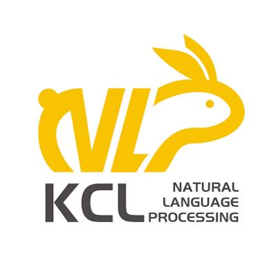

<h1 align="center">GroupAssistBench</h1>

<h3 align="center">
  One Assistant, Many Memories: Benchmarking Real-World Group Assistance When Recall Is Not Enough
</h3>

<p align="center">
  Zhanghao Hu*, Linhai Zhang*, Qian Zhao, Qi Zhu, Yuan Hua,
  Di Liang, Jiasheng Si, Xin Zhao, Yulan He, Zhumin Chen†, Lin Gui†
</p>

<p align="center">
  📄 <a href="https://huggingface.co/papers/2611.04867">Paper on Hugging Face</a> |
  📄 <a href="https://arxiv.org/abs/2611.04867">arXiv Preprint</a> |
  🤗 <a href="https://huggingface.co/datasets/tencent/GroupAssistBench">Dataset on Hugging Face</a> |
  🔥 <a href="https://zhanghao-groupassisbench.github.io/Academic-project-page-template/">Project Page</a>
</p>

<br>

<b>Research Collaboration</b>

<p align="left">
  <a href="https://yuanbao.tencent.com/">
    
  </a>
  &nbsp;
  <a href="https://yuanbao.tencent.com/">
    <b>Tencent Yuanbao Team</b>
  </a>
</p>

<p align="left">
  <a href="https://kclnlp.github.io/">
    
  </a>
  &nbsp;
  <a href="https://kclnlp.github.io/">
    <b>KCL NLP Group</b>
  </a>
  · King's College London
</p>

> 英文版见 [README.md](README.md)。

---

## 简介

The value of memory lies not only in recall but in using it to provide appropriate assistance. Recent benchmarks test memory use in personalisation and agentic tasks, but seldom evaluate assistance without fixed answers or integration across multiple participants. Group chats make both challenges more acute: an assistant must integrate information from multiple members, track revisions and conflicts over time, and produce one response for the group. Yet existing group memory benchmarks rely on synthetic conversations and inherit constrained evaluation from general memory benchmarks, focusing on recall against fixed answers or decisions over a closed set. We introduce GroupAssistBench, the first memory benchmark from real-world group conversations with a deployed group assistant, covering 80,299 messages in 50 groups and costing over $53K. Over the same histories, GroupAssistBench evaluates memory recall (L1) with reference answers and memory use (L2) with service requests without fixed answers across single, distributed, and conflicting memories (M1–M3). Requests are verified to require group history, memories are anchored to their sources, and L2 uses tailored rubrics with penalties derived from real user feedback. Across evaluations of frontier models with full context, retrieval methods, and memory systems, the strongest memory system rivals full context on recall but falls far behind on use, especially for distributed and conflicting memories. Together, two additions that relate retrieved memories and bind remembered facts as response constraints bring consistent gains, showing that group memory systems must improve use, not recall alone.

## 概览

本仓库包含 GroupAssistBench 数据集，以及把群聊记录构建成评测题目的代码（[论文](https://arxiv.org/abs/2611.04867)第 3.2 节）。

```text
P1 接入群聊
  → P2 定位向助手发出的请求，保留依赖群历史的
  → P3 抽取回答所依赖的历史事实（锚点）
  → P4 判定记忆结构、操作类型与 L1/L2
  → P5 构题：沿用群里原有的请求，或根据锚点写出新题面；另外构造冲突记忆（D3）题
  → 质量闸门与验收
```

## 1. 目录

```text
.
├── assets/                   # README 中用到的 logo
├── dataset/                  # 发布数据集: 50 个群, 2,395 题
│   ├── items.jsonl           #   评测格式: 题面、L1 答案(gt/gt_atoms)、L2 评分项(criteria)、截断点
│   ├── items_full.jsonl      #   同一批题的构造记录: 锚点、来源、事件簇、L1/L2 配对
│   ├── contexts.json         #   脱敏后的群聊全文
│   ├── contexts_en.json      #   contexts.json 的英文参考译文(机器翻译)
│   ├── cutoffs.json          #   每题的截断轮次: 只能读这一轮之前的历史
│   ├── manifest.json         #   2,395 个题号, 按群/层级/难度分桶
│   ├── profiles.json         #   成员档案
│   └── dataset_meta.json     #   统计信息与各文件 SHA-256(可用 sha256sum 校验)
├── demo/                     # 一个群(4368)的完整示例
│   ├── demo_4368_raw.jsonl          # 输入: 群聊
│   ├── demo_4368_annotations.jsonl  # 输入: 人工标注
│   └── demo_4368/                   # 跑完全部步骤后的 run 目录
├── pipeline/                 # 各阶段代码
│   ├── ingest.py / ingest_xlsx.py   # P1: 读取 JSONL / XLSX 群聊
│   ├── p2_locate.py          # P2
│   ├── p3_anchor.py          # P3
│   ├── p4_classify.py / p4_layer.py # P4: 记忆结构与操作类型 / L1、L2
│   ├── p4_d3.py / p4_conflict.py    # D3 素材: 更新事件 / 多方冲突
│   ├── r7_pairs_screen.py    # D3 更新事件三轮投票筛查
│   ├── p5_build.py           # P5 构题及答案、评分标准
│   ├── gates.py              # 质量闸门
│   └── llm.py / examples.py / contract.py / refresh_run_meta.py / run_pipeline.py
├── tools/
│   ├── build_eval_bundle.py  # run 目录 → 评测包
│   ├── sample_manifest.py    # 评测包 → 均衡子集
│   └── audit_canonical.py    # 验收
├── scripts/                  # 01–05 五个运行脚本 + 离线冒烟测试
├── LICENSE_Code.txt          # 代码协议
└── LICENSE_Dataset.txt       # 数据集协议(CC BY-NC 4.0)
```

发言人均以 `user_N` 或人名形式的化名出现，已替换真实身份。

**英文参考译文**：为保留真实对话的原貌，群聊数据的主体仍为中文原文；考虑到语言上的通用性，
我们另外提供用 GPT-5.5 翻译的英文版群聊数据 `dataset/contexts_en.json`，供大家参考。
`contexts.json` 仍是原始数据，`items.jsonl` 中的题目为中文。两个文件的结构、群名键、消息顺序和轮次号完全一致。
请按位置对应消息，因为个别群内存在重复的轮次号。发言人姓名已转换为拼音。

**术语对照**：代码中的 `difficulty` D1/D2/D3 对应论文的 M1/M2/M3（单条记忆 / 多条记忆 / 冲突记忆）；
`layer` L1/L2 对应论文的记忆召回 / 记忆运用；`cut_turn` 即截断点。

## 2. 环境

需要 Python 3.9+ 和一个 OpenAI 兼容的 Chat Completions 接口。

```bash
python3 -m venv .venv && source .venv/bin/activate
pip install -r requirements.txt
cp env.example .env        # 填写 OPENAI_API_KEY, 必要时填写 OPENAI_BASE_URL
```

`env.example` 中已给出默认模型（GPT-5.5）和其余配置。接口不支持 JSON 模式时设 `FORCE_JSON=0`。

## 3. 输入格式

**JSONL**：每行一条消息，至少包含 `group_id`、`idx`（群内递增序号）、`send_uid`、`content`，
可选 `event_time_iso`。助手消息的 `send_uid` 为 `yuanbao`。

```json
{"group_id": "demo", "idx": 1, "send_uid": "user_1", "content": "@元宝 帮我整理刚才确定的安排", "event_time_iso": "2026-01-01T10:00:00"}
```

**XLSX**：至少包含表头 `轮次`、`聊天记录-发言人`、`聊天记录-内容`，按表头名读取。

## 4. 运行步骤

| 步骤 | 脚本 | 做什么 | 调用模型 |
|---|---|---|---|
| 01 | `01_run_base.sh` | P1–P5：定位请求、抽锚点、判定标签，生成题目和 D3 素材 | 是 |
| 02 | `02_screen_d3.sh` | 对每个 D3 更新事件独立投票三次，分为 green / yellow / red | 是 |
| 02b | （人工） | 复核 yellow / red 事件，可选 | 否 |
| 03 | `03_finalize_d3.sh` | 生成 D3 题并验收 | 是 |
| 04 | `04_build_bundle.sh` | 汇总所有群的合格题（`status == "built"`），生成评测包 | 否 |
| 05 | `05_sample_manifest.sh` | 从评测包中选出均衡子集 | 否 |

01–03 按群运行，每个群产出一个 run 目录（`pipeline_runs/<RUN_DIR>/`）；04–05 汇总所有群。
每一步都会复用目录里已有的产物，中断后重跑即可续上。

### 4.1 Demo

demo 用来熟悉代码：对照一个真实群（4368，249 条消息）看每一步的输入和输出。

- 起点：`demo/demo_4368_raw.jsonl` 和 `demo/demo_4368_annotations.jsonl`；
- 结果：`demo/demo_4368/`，即构建发布数据集时该群跑完全部步骤的 run 目录。数据集中该群的 19 道题都在它的 `eval_bundle/items_adapted.jsonl` 里。

从头运行（需要 API key，约一小时）：

```bash
export PIPE_ANNOTATIONS_JSONL=demo/demo_4368_annotations.jsonl
bash scripts/01_run_base.sh 4368 "$PWD/demo/demo_4368_raw.jsonl" demo_4368 6 all
bash scripts/02_screen_d3.sh demo_4368 3
bash scripts/03_finalize_d3.sh 4368 demo_4368
bash scripts/04_build_bundle.sh pipeline_runs/demo_4368/eval_bundle
bash scripts/05_sample_manifest.sh pipeline_runs/demo_4368/eval_bundle 5
```

由于大部分阶段调用模型，从头运行的结果会和 `demo/demo_4368/` 不同。发布数据以 `dataset/` 为准。

### 4.2 在自己的数据上运行

```bash
# 01: 输入可以是 .jsonl 或 .xlsx; 后两个参数为并发数和新写题面的数量上限(all 表示不设上限)
bash scripts/01_run_base.sh <GID> /path/to/messages.jsonl <RUN_DIR> 4 all

# 02: 结果写入 pipeline_runs/<RUN_DIR>/d3_pairs_r7.json, 人工审阅表为同目录下的 r7_pairs_review.md
bash scripts/02_screen_d3.sh <RUN_DIR> 3

# 03: 只使用 green 事件; 或传入人工判定文件(见下)
bash scripts/03_finalize_d3.sh <GID> <RUN_DIR> [/path/to/d3_human_verdicts.jsonl]

# 04-05: 汇总 pipeline_runs/ 下的全部 run 目录
bash scripts/04_build_bundle.sh eval_bundles/my_set
bash scripts/05_sample_manifest.sh eval_bundles/my_set 1500
```

人工判定文件每行一条，`verdict_human` 取 `true_update`、`different_slot`、`range_extension`、
`goal_vs_status`、`rephrase` 之一；只有判为 `true_update` 的 yellow / red 事件才会出题：

```json
{"pair_key": "12->34", "verdict_human": "true_update", "note": ""}
```

05 的第二个参数可以是一个数字（每格目标题数），也可以逐格指定，如 `"L1D1=780,L1D2=684,L2D1=0,L2D2=650"`（0 表示该格全部保留）。

04、05 会收集 `pipeline_runs/` 下的所有 run 目录，同一个群只保留一次运行。

## 5. 检查

```bash
bash scripts/smoke_offline.sh                   # 离线冒烟, 不调用模型
python3 tools/audit_canonical.py <RUN_DIR>      # 验收一个 run 目录
```

数据量很小的群可能因为某些 `层级 × 难度` 格为空而验收不通过，这时 03 会以非零状态退出，不代表运行出错。

## 许可协议

GroupAssistBench **仅限非商业用途**。代码和数据分别采用两份协议：

| 部分 | 范围 | 协议 |
|---|---|---|
| 代码 | `pipeline/`、`tools/`、`scripts/`、`env.example`、`requirements.txt` | [License Terms of GroupAssistBench](LICENSE_Code.txt)：基于 MIT 条款，附加**仅限学术用途**的限制，不得用于任何商业或生产用途 |
| 数据集 | `dataset/` 及 `demo/` 下的数据文件 | [CC BY-NC 4.0](LICENSE_Dataset.txt)：署名后可使用、分享和改编，**仅限非商业用途** |

`assets/` 中的 logo 归各自所有者所有，不在上述协议范围内。

Copyright (C) 2026 Tencent. All rights reserved.

## 引用

如果 GroupAssistBench 对你有帮助，请引用：

```bibtex
@misc{hu2026assistantmemoriesbenchmarkingrealworld,
      title={One Assistant, Many Memories: Benchmarking Real-World Group Assistance When Recall Is Not Enough},
      author={Zhanghao Hu and Linhai Zhang and Qian Zhao and Qi Zhu and Yuan Hua and Di Liang and Jiasheng Si and Xin Zhao and Yulan He and Zhumin Chen and Lin Gui},
      year={2026},
      eprint={2611.04867},
      archivePrefix={arXiv},
      primaryClass={cs.CL},
      url={https://arxiv.org/abs/2611.04867},
}
```
